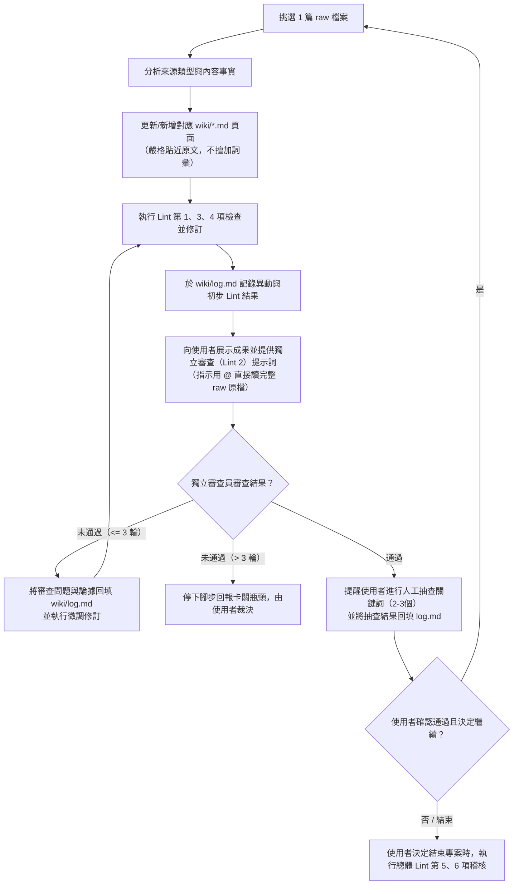

# 西式建築風格 LLM Wiki 營運與維護規範 (AGENTS.md)

本文件為「西式建築風格 LLM Wiki」專案的唯一最高準則，定義本知識庫的目標、架構、原始資料處理規則、標記規範、Ingest 流程與品質審查（Linting）機制。所有參與本 Wiki 維護、撰寫與審查之 Agent 均須嚴格遵守。

---

## 1. 專案核心定位與語言規範

* **主題**：西式建築風格（核心涵蓋：**古羅馬**、**哥德式**、**巴洛克** 三大經典風格）。
* **目標受眾**：完全沒學過建築的零基礎初學者。
* **主要用途**：作為未來製作初學者「教學 HTML 簡報」的結構化知識庫。
* **語言規範**：
  * 全文使用標準**繁體中文**。
  * 關鍵建築專有名詞與世界知名地標，於各頁面**首次出現時必須附上原文對照**（如：萬神殿 *Pantheon*、肋架拱頂 *Ribbed vault*、飛扶壁 *Flying buttress*）。

---

## 2. 原始資料分類、權重與維護準則（依檔案 Frontmatter 判定）

### 2.1 raw/ 目錄唯讀鐵則
* **嚴格唯讀**：在任何情況下，Agent **均不得修改、刪除、更名或移動 `raw/` 目錄內的任何檔案**。
* **客觀基準**：`raw/` 檔案為事實查核與忠實度審查的唯一標準依據，必須永久保持原始樣貌。

### 2.2 來源分類與可靠度權重
不得依檔名猜測資料性質，必須依據 `raw/*.md` 檔案開頭 YAML 區塊（Frontmatter）的 `來源類型` 與 `來源單位` 判定可靠度等級：

| 等級 | 涵蓋來源類型 / 單位範例 | 定位與採納原則 |
| :--- | :--- | :--- |
| **A 級（高可靠度史實基準）** | `來源類型：維基百科`、官方介紹（如博物館、古蹟官方） | **客觀史實之最高準繩**。歷史年份、營造技術、正統學術定義一律以此為準。 |
| **B 級（概念參考與教育詮釋）** | `來源類型：百科或教育網站`（如室內設計、建築教育營） | 適合做白話概念拆解、特色解說與教學切入視角。 |
| **C 級（個人視角與心得整理）** | `來源類型：風格比較`、部落格專欄（如方格子、個人旅遊心得） | 含有大量作者個人教學理解、主觀比喻與實地旅遊心得。 |

### 2.3 資料衝突與單一來源處理規則：
1. **事實衝突處理**：當 B 級或 C 級資料與 A 級資料在客觀事實（年代、技術、歷史定論）發生矛盾時，**一律以 A 級資料為準**；同時在 Wiki 內標註 `⚠️【說法分歧】` 客觀並陳 B/C 級觀點，嚴禁 Agent 自行偏頗或選擇忽視。
2. **單一低可靠來源處理**：若某個建築細節或觀察**僅出現在 C 級來源**（A/B 級皆未提及），允許收錄以豐富教學內容，但該句子/段落末尾**強制標記**：
   `⚠️【單一來源，可靠度較低 ｜ 來源: raw/xxx.md】`，絕不可作為既定史實陳述。

---

## 3. Wiki 目錄與檔案結構規劃

所有產出檔案均存放在專案子目錄 `wiki/` 內，檔名規範如下：

```
wiki/
├── index.md                   # 全景時間軸、風格演進地圖與全站導覽首頁
├── 01-ancient-roman.md        # 古羅馬建築（實用工程、混凝土革命、公共建築）
├── 02-gothic.md               # 哥德式建築（宗教狂熱、垂直向上、光之神性）
├── 03-baroque.md              # 巴洛克建築（戲劇張力、流動曲線、情緒震撼）
├── 04-style-comparison.md     # 三大風格綜合對照表與 3 步驟實戰一眼辨識決策樹
└── log.md                     # Ingest 步進工作日誌與歷史更新紀錄
```

---

## 4. 單篇風格專章標準骨架（Template）

`01-ancient-roman.md`、`02-gothic.md`、`03-baroque.md` 必須嚴格遵照以下統一結構排版：

1. **核心金句**：開篇第一句，標註 `💡【AI 綜合提煉】`，一秒抓住風格神髓。
2. **時代背景與動機**：依 A 級來源整理「為什麼那個時代會蓋成這樣？」，句句標註 `[來源: raw/xxx.md]`。
3. **核心視覺招牌（至多 3 項，寧缺毋濫）**：
   * 依原始資料客觀紀錄 1～3 項，**嚴禁為湊滿三項而編造**。
   * 來源事實帶出處標籤；輔助理解的生活化比喻統一標註 `📌【AI 補充 / 教學比喻，非原始來源】`。
4. **代表地標案例（依來源實情收錄，寧缺毋濫）**：
   * **寧缺毋濫原則**：比照核心視覺招牌，raw 資料只支持幾座就寫幾座，**嚴禁為了湊滿 2～3 座而補入 raw 沒有的案例或細節**。
   * **資料不足處理**：若該篇 raw 資料缺少代表地標，段落末尾明確註記「待後續資料補充」，史實與特色皆標註來源。
   * 附上初學者專用打卡指南，標註 `📌【AI 補充 / 打卡看點，非原始來源】`。
5. **簡報製作提示（Slide Cues）**：
   * 提供未來轉做 HTML 簡報的直接指引，標註 `🎬【AI 補充 / 簡報建議，非原始來源】`（包含：建議配圖方向、單頁速記口訣、3-4個條列重點）。

---

## 5. 事實標註、出處追溯與 AI 標籤隔離原則

本 Wiki 實行**「零灰色地帶」**規範，讀者必須能一眼區分何為客觀文獻、何為 AI 輔助生成：

1. **嚴格事實追溯與貼近原文原則（Citation & Raw Fidelity）**：
   * 凡客觀事實、數據、年份、特徵描述，句末必須標註 `[來源: raw/檔案名.md]`。
   * **句子高度貼近原文**：標註來源之句子，**內容必須貼近 raw 原文，只能整理或改寫 raw 有的內容，嚴禁加入 raw 沒有的詞彙、因果關係、主觀評價、地理位置或背景知識**。
   * **背景知識隔離**：若想補充任何 raw 沒寫的背景知識（如地理河川、歷史背景），**必須放進 `📌【AI 補充】` 標籤內**，並明確註明為「AI 背景知識」，絕不可寫為來源事實。
   * 未在 `raw/` 找到對應出處之內容，**嚴禁寫為事實**。
2. **AI 輔助內容隔離**：
   * 生活化比喻、記憶口訣、30 秒打卡看點、3 步驟決策樹、簡報視覺提示，若非 raw 檔案原文，必須使用專屬標籤框隔離（例如：`📌【AI 補充 / ...】`、`🎬【AI 補充 / ...】`）。
3. **跨篇綜合內容標記**：
   * `wiki/index.md` 的歷史時間軸、`wiki/04-style-comparison.md` 的橫向對照表等跨篇提煉產物，個別細節標註來源，區塊開頭必須標明：
     `📌【AI 跨篇綜合整理，參考來源：raw/A.md、raw/B.md】`。

---

## 6. 單篇步進式 Ingest 流程規範

嚴格禁止一次性批次處理全部 raw 檔案，必須依序單篇推進。不強制要求一次處理完全部 raw 檔案，使用者可依額度隨時暫停或結束。



### 6.1 `wiki/log.md` 記載欄位要求：
每一次 Ingest 與後續修訂，必須於 `wiki/log.md` 依序記錄：
* **處理日期**（如：2026-11-17）
* **處理檔案**（如：`raw/baroque-wikipedia.md`）
* **來源等級**（A 級、B 級或 C 級）
* **影響 Wiki 檔案**（如：更新 `wiki/03-baroque.md`、`wiki/index.md`）
* **提煉重點摘要**（本次主要新增或修正了哪些核心論點與案例）
* **Lint 結果與修正（含每一輪審查回填）**：
  * **每一輪審查均須記錄**（包含未通過之輪次）：標明第幾輪修訂、獨立審查員提出之問題、審查員給予之原文依據或誤判判定、人工核實結果與最終如何修訂；
  * 若當輪審查無問題，明確標註「第 X 輪審查通過」；
  * **記錄人工抽查結果**：記載使用者抽查 2～3 個關鍵詞之比對結論。
* **raw/ 檔案處理狀態清單**（明確標示 `raw/` 內所有檔案為「已處理」或「未處理」；未處理者為正常狀態，不算違規）

### 6.2 流程循環防呆規則（修改上限 3 輪）
當使用者或獨立審查員檢查未通過時，Agent 依據意見微調修訂的循環**上限為 3 輪**。若連續修訂 3 輪仍無法通過，Agent 必須主動停下腳步，具體列出卡關瓶頸與歧異點，交由使用者做最終裁決，嚴禁陷入無限自動修改迴圈。

### 6.3 審查通過後之「人工抽查確認機制」
當新對話之獨立審查員判定「忠實度審查通過」後，撰寫 Agent **必須主動提醒使用者至 raw 原檔搜尋 2～3 個關鍵詞**，進行最終人工雙重查核，確保審查結果具備客觀真實性，並將該抽查紀錄寫入 `wiki/log.md`。

---

## 7. 品質維護與 Lint 檢查清單（分階段與獨立審查）

品質檢查分為**「單篇 Ingest 檢查（第 1～4 項）」**與**「專案結尾總體驗收（第 5～6 項）」**：

### 單篇 Ingest 執行項目（每次處理均需執行）：
1. **未標出處檢查（Missing Citation Lint）**：檢查 Wiki 內是否存在漏標來源的客觀事實陳述。
2. **忠實度與正確性審查（Fidelity & Fact-Check Lint - 獨立新對話審查）**：
   * **啟動機制**：為避免自我護短與合理化幻覺，撰寫 Agent **嚴禁在同一對話中自我審查**。
   * **操作方式與原檔依歸（禁摘錄）**：每次 Ingest 完成後，由 Agent 主動提醒使用者**另開新對話**，並生成審查 Prompt。**Prompt 嚴禁自作主張摘錄或改寫 raw 內容，必須明確指示審查員使用 `@` 直接讀取完整的 `raw/*.md` 原檔與對應的 `wiki/*.md` 頁面**。
   * **審查員必須附證據規範**：Prompt 必須強制要求審查員進行逐句核對，**每一個違規指控與每一個通過判定，都必須附上在 raw 原檔中找到的原句與精確行數（Line number）；唯有在完整 raw 原檔中確實找不到對應原句時，才可以判定違規**。
3. **低可靠單一來源標記檢查（Low-Reliability Citation Lint）**：確認僅在 C 級來源出現的資訊是否皆附有 `⚠️【單一來源，可靠度較低】` 標籤。
4. **AI 標記完整性檢查（Untagged AI Content Lint）**：確認所有非原始文獻之比喻、口訣、簡報提示是否皆有明確 AI 標記。

### 專案結尾執行項目（使用者決定全庫結束或暫停時執行）：
5. **跨頁面一致性檢查（Cross-Page Consistency Lint）**：檢查各頁面之間（如羅馬專章與綜合比較篇）對相同年代或特徵之描述是否一致。
6. **原料狀態與死結檢查（Raw Status & Broken Link Lint）**：
   * 檢查 `raw/` 內所有檔案是否皆已在 `wiki/log.md` 中標記為「已處理」或「未處理」（未處理檔案不視為違規）。
   * 驗證 Wiki 內部所有 Markdown 超連結皆有效可用。
